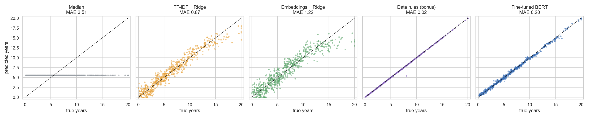

# Predicting Years of Experience from CV Images with PaddleOCR and BERT

End-to-end document-AI system: a CV **image** goes through **PaddleOCR**, the text is cleaned, and five
models predict the candidate's **years of work experience (0-20)** — a median guess, TF-IDF + Ridge,
frozen sentence embeddings + Ridge, a **fine-tuned DistilBERT regressor**, and (bonus) a date-counting
rule. All models share one OCR output, one train / validation / test split and one evaluation.

**Headline (600 test CVs):** fine-tuned BERT reaches **MAE 0.20 years** (100% within ±2 years), cutting
the TF-IDF error by 0.67 years (95% CI [0.61, 0.73]) — but a 20-line regex that sums job date ranges
reaches **MAE 0.025**, and a perturbation probe shows BERT learned a shortcut rather than date arithmetic.

> Course: Machine Learning / NLP / Applied AI · Video: see [`video/link.txt`](video/link.txt)

---

## Contents
1. [What the project does and for whom](#1-what-the-project-does-and-for-whom)
2. [Data, sampling and target](#2-data-sampling-and-target)
3. [OCR: PaddleOCR setup and reading order](#3-ocr-paddleocr-setup-and-reading-order)
4. [OCR quality](#4-ocr-quality)
5. [Cleaning and masking](#5-cleaning-and-masking)
6. [Split](#6-split)
7. [Baselines](#7-baselines)
8. [BERT regression](#8-bert-regression)
9. [Results](#9-results)
10. [Analytical questions](#10-analytical-questions)
11. [Limitations and business applications](#11-limitations-and-business-applications)
12. [How to reproduce](#12-how-to-reproduce)
13. [Streamlit app](#13-streamlit-app)
14. [Repository structure](#14-repository-structure)

---

## 1. What the project does and for whom

Recruiters estimate a candidate's experience by scanning every job, reading its dates, adding the
durations and ignoring education and gaps. The number is almost never written on the CV. This project
measures how well models of increasing complexity can learn that skill from OCR text, how much OCR
noise costs, and whether the expensive model is worth deploying.

Potential users are recruiting agencies, job boards, public employment services and HR teams that
receive CVs as images or PDFs and want to **pre-fill** an experience field that a person then checks.
It is **not** meant to decide who gets an interview (see [Q4](#q4--business-value-fairness-and-ethics)).

## 2. Data, sampling and target

* **Dataset:** PopResume (Yu, Park & Moon, EMNLP 2026, CC BY 4.0) — 60,884 synthetic resumes for 5
  occupations, rendered as images with and without a synthetic photo, generated from U.S. population
  statistics (no real person's data).
* **Sample:** for each occupation the image shards are **streamed**, filtered to `has_photo == False`,
  shuffled with `seed=42, buffer_size=5000` and the first **800** rows are kept → **4,000 CVs**
  (800 × 5). Images are kept as compressed bytes in the shuffle buffer (decoding 5,000 pages would need
  ~30 GB of RAM). IDs: [`data/raw/sampled_ids.csv`](data/raw/sampled_ids.csv).
* **Kept attributes:** id, occupation, `exp_year`, education level, and sex / race (**only** for the
  fairness check). Age, names, state and region are never stored.
* **Reference text:** the `text` config is loaded for the sampled IDs and used **only** to measure OCR
  error and for the OCR-noise experiment (Q2) — never to train or select a model.
* **Target:** `exp_year` (continuous, 0.0-24.7 in the sample) clipped to **0-20**; predictions are
  clipped to the same range. **29 CVs (0.7%) sit at the cap**, far below the 15% threshold, so the cap
  stays at 20 for every model.

| Occupation | CVs | Mean years | Median years |
|---|---|---|---|
| Accountants & auditors | 800 | 7.32 | 6.54 |
| Construction laborers | 800 | 5.78 | 4.30 |
| Elementary / middle school teachers | 800 | 6.84 | 5.68 |
| Registered nurses | 800 | 6.38 | 5.57 |
| Software developers | 800 | 6.25 | 5.40 |
| **All** | **4,000** | **6.52** | **5.57** |

The distribution is right-skewed (quartiles 3.0 / 5.6 / 9.2 years): 14.6% of CVs have ≤ 2 years and
very few exceed 15 ([figure](output/figures/target_distribution.png)).

Every CV follows one template: name banner, a "STATE, USA | phone | e-mail" line, **WORK HISTORY**
(1-4 jobs, each "Title, Company, YYYY.MM–YYYY.MM" + bullets) and **EDUCATION** (degree, school, year).
A quick check on the reference text shows that `exp_year` is the sum of the job durations (MAE
0.02 years), so the evidence is entirely in the dates.

## 3. OCR: PaddleOCR setup and reading order

* **PaddlePaddle 3.2.0 (CPU) + PaddleOCR 3.3.1**, detection **PP-OCRv5_mobile_det**, recognition
  **en_PP-OCRv5_mobile_rec**; document orientation, unwarping and text-line orientation disabled.
* **Why mobile:** everything runs on a laptop CPU (Intel Core i7-13620H, 10 cores, no CUDA GPU). The
  pages are clean digital renders at 1241 × 1754, so the server models' extra accuracy is not needed;
  the mobile models reach 99.996% year accuracy (Section 4).
* **Throughput:** 2.73 s per CV on average (median 2.53 s), 3.0 hours for 4,000 CVs, **0 failed
  images**, mean line confidence **0.991**, 14.4 lines per CV. One process using all threads was
  faster than two processes with 5 threads each; lowering the detection resolution to 960 px changed
  the text of 5/6 test CVs, so the default resolution was kept.
* **Cache:** one JSON per CV in [`data/ocr/`](data/ocr) with every line's text, confidence and box,
  the timing and the model names. The job is resumable.
* **Reading order** ([`src/ocr_extraction.py`](src/ocr_extraction.py)): boxes are grouped into visual
  rows (vertical centre within ½ median line height), rows are read top-to-bottom and boxes inside a
  row left-to-right, so a job title and its dates stay on one line. For **two-column layouts** a gutter
  detector searches the central 15-85% of the page for an x position that (almost) no box crosses,
  with boxes on both sides covering ≥ 40% of the page height; if found, full-width headers above the
  columns are read first, then the whole left column, then the right one — reading column by column
  keeps each job next to its dates instead of interleaving a sidebar. In PopResume all 4,000 pages
  were detected as single-column.

## 4. OCR quality

Both texts are normalised the same way (NFKC, lower case, unified dashes and quotes, collapsed
whitespace) and compared with **jiwer** ([`src/ocr_quality.py`](src/ocr_quality.py)).

| Occupation | CER | WER | Years read correctly | Ranges intact (as read) | Ranges after dash repair | Dash dropped |
|---|---|---|---|---|---|---|
| Accountants & auditors | 1.10% | 7.66% | 100% | 55.0% | 100% | 45.0% |
| Construction laborers | 0.95% | 6.50% | 100% | 53.7% | 100% | 46.3% |
| Teachers | 0.94% | 6.51% | 99.98% | 58.3% | 98.2% | 39.9% |
| Registered nurses | 1.34% | 8.91% | 100% | 39.1% | 100% | 60.9% |
| Software developers | 1.50% | 9.83% | 100% | 36.4% | 100% | 63.6% |
| **All** | **1.17%** | **7.88%** | **99.996%** | **48.6%** | **99.6%** | **51.0%** |

* **Years:** 24,382 of 24,383 reference years appear with the right digits; 99.98% of CVs have every
  year right.
* **Where it fails:** (1) PaddleOCR **drops the en dash** between dates in 51% of ranges
  (`2017.10–2020.06` → `2017.102020.06`), which breaks any date parser until repaired; (2) on 36
  teachers' CVs the job line is so long that the recogniser **loses the last digit(s)** (`2023.0`,
  `2023.`). Most of the remaining WER is bullets ("•" read as "-" or dropped) and spacing.

## 5. Cleaning and masking

[`src/preprocessing.py`](src/preprocessing.py), in order:

1. **Reading order** from the boxes (Section 3).
2. **Date normalisation:** unify "–", "—", "~" to "-"; **re-insert the dropped dash**
   (`2017.102020.06` → `2017.10 - 2020.06`; unambiguous because months always have two digits); fix
   O→0, l/I→1, S→5 inside date tokens.
3. **Broken lines:** join hyphenated line ends and bullets that wrapped to a new line.
4. **PII removal:** everything above the first section header (name banner and the "state | phone |
   e-mail" line) is dropped; stray e-mails, phone numbers and URLs are removed. Job dates and
   graduation years are kept — they are the evidence.
5. **Masking of direct answers:** regexes for total experience ("12 years of experience", "over a
   decade of experience", "Experience: 8+ yrs"), age ("age 34", "34-year-old") and date of birth
   ("born", "DOB", "date of birth") replace the phrase with `[MASKED]`.

**Low-confidence lines are kept.** No OCR line scores below 0.95, and a 0.98 threshold would remove
11.5% of all lines including 6.6% of the job-date lines; Q3 shows that removing them hurts every
model. **Masking:** 50 random cleaned OCR texts were read by hand
([log](output/tables/manual_review_50_ocr_texts.csv)) and the regexes were run on all 4,000 CVs:
**0 CVs** state total experience, age or date of birth (PopResume CVs have no summary section). The
masking step is still part of the pipeline and logged in `data/processed/masking_log.csv`.

Output: [`data/processed/cvs.csv`](data/processed/cvs.csv) with `text` (cleaned OCR, the model input),
`text_raw` (reading order + PII removal + masking only), `text_lowconf` (cleaned, lines with
confidence < 0.98 removed) and `text_ref` (reference text cleaned identically, Q2 only).

## 6. Split

[`src/split.py`](src/split.py): split by CV id, **70 / 15 / 15** (2,800 / 600 / 600), stratified jointly
by occupation and experience band (0-2, 3-5, 6-10, 11-20), `seed=42`. IDs are in
[`data/splits/`](data/splits). Every model reads these files; all tuning uses validation only and the
test set is touched once, in the final evaluation.

## 7. Baselines

| Model | Setup | Tuning (validation) |
|---|---|---|
| **Median** ([code](src/baseline_median.py)) | always predicts the training median (5.56 years) | — |
| **TF-IDF + Ridge** ([code](src/baseline_tfidf.py)) | word 1-2 grams + char_wb 3-5 grams, sublinear TF, ≤ 100k features each; target / 20 | Ridge α ∈ {0.1 … 30} → **α = 0.1** |
| **Embeddings + Ridge** ([code](src/baseline_embeddings.py)) | frozen **BAAI/bge-small-en-v1.5** (384-d, normalised); CVs longer than 512 tokens would be split into ≤ 510-token chunks and their vectors averaged (no CV needed it) | Ridge α ∈ {0.01 … 10} → **α = 0.03** |
| **Date rules** (bonus, [code](src/baseline_rules.py)) | regex for `YYYY.MM - YYYY.MM` in the work-history section, overlaps merged, durations summed; falls back to the median if no date is found | none |

**Numbers in TF-IDF are kept as tokens**: a year is weak but real evidence of career length, and
removing digits (all replaced by "0") raises the test MAE from 0.87 to 1.69 (Q3).

## 8. BERT regression

[`src/train_bert.py`](src/train_bert.py)

* **Model:** `distilbert-base-uncased` via
  `AutoModelForSequenceClassification.from_pretrained(name, num_labels=1, problem_type="regression")`.
  DistilBERT is the lightest option that trains in reasonable time on a CPU.
* **Target scaling:** `y / 20` during training; predictions × 20, clipped to 0-20.
* **Loss:** MSE (main); Huber (δ = 0.1 on the scaled target) compared in Q3.
* **Long CVs:** the code supports head, head + tail and chunking (mean of window predictions). The
  longest cleaned CV has **~190 word-pieces**, so with `max_len = 256` **nothing is truncated and every
  date survives**; the head + tail strategy (128 + 126) is the default but never activates here.
* **Hyper-parameters:** AdamW, lr 5e-5, weight decay 0.01, linear warm-up 10%, batch size 16, up to 15
  epochs, gradient clipping 1.0, early stopping on **validation MAE** (patience 3), seed 42; batches are
  length-bucketed to reduce padding on CPU.
* **Training:** best validation MAE **0.197** at epoch 10, stopped after epoch 13; **88 minutes** on the
  Intel Core i7-13620H (CPU only, 10 threads), 6.8 min per epoch. Inference 0.031 s per CV.

## 9. Results

[`output/tables/model_comparison.csv`](output/tables/model_comparison.csv) — test set, 600 CVs:

| Model | MAE (years) | RMSE (years) | Acc ±1 | Acc ±2 | Acc ±3 | Band accuracy | Band macro-F1 | R² | Training time | Inference time per CV |
|---|---|---|---|---|---|---|---|---|---|---|
| Median | 3.507 | 4.491 | 16.7% | 34.7% | 51.8% | 32.2% | 0.122 | −0.050 | < 1 ms | < 1 µs |
| TF-IDF + Ridge | 0.874 | 1.118 | 65.0% | 93.3% | 99.0% | 83.2% | 0.837 | 0.935 | 15 s | 0.6 ms |
| Embeddings + Ridge | 1.223 | 1.564 | 48.0% | 83.3% | 95.3% | 75.0% | 0.756 | 0.873 | 2.5 min | 21 ms |
| **Fine-tuned BERT** | **0.203** | **0.273** | **99.5%** | **100%** | **100%** | **95.2%** | **0.953** | **0.996** | 88 min | 31 ms |
| Date rules (bonus) | 0.025 | 0.111 | 99.8% | 99.8% | 100% | 98.8% | 0.988 | 0.999 | 0 s | 0.01 ms |

**BERT's MAE gain** (baseline MAE − BERT MAE, 95% paired bootstrap, 2,000 resamples,
[table](output/tables/bert_gain_bootstrap.csv)):

| vs | Gain | 95% CI | Significant |
|---|---|---|---|
| Median | 3.30 | [3.08, 3.53] | yes |
| TF-IDF + Ridge | 0.67 | [0.61, 0.73] | yes |
| Embeddings + Ridge | 1.02 | [0.94, 1.10] | yes |
| Date rules | −0.18 | [−0.20, −0.16] | yes (rules better) |

**MAE by true band / by occupation** ([band](output/tables/mae_by_band.csv),
[occupation](output/tables/mae_by_occupation.csv)):

| Band | Median | TF-IDF | Embeddings | BERT | Rules |
|---|---|---|---|---|---|
| 0-2 | 4.19 | 0.87 | 1.09 | 0.23 | 0.02 |
| 3-5 | 1.55 | 0.78 | 1.14 | 0.18 | 0.02 |
| 6-10 | 2.26 | 0.83 | 1.06 | 0.19 | 0.03 |
| 11-20 | 8.21 | 1.13 | 1.78 | 0.24 | 0.02 |

| Occupation | TF-IDF | Embeddings | BERT | Rules |
|---|---|---|---|---|
| Accountants & auditors | 0.90 | 1.28 | 0.18 | 0.02 |
| Construction laborers | 0.86 | 1.10 | 0.24 | 0.02 |
| Teachers | 0.94 | 1.31 | 0.17 | 0.04 |
| Registered nurses | 0.79 | 1.12 | 0.22 | 0.02 |
| Software developers | 0.89 | 1.30 | 0.21 | 0.02 |

**Predicted vs true** (dashed = 45° line):



The baselines pull predictions toward the middle: mean signed error on 11-20-year CVs is −0.91
(embeddings), −0.39 (TF-IDF) and −0.16 (BERT); on 0-2-year CVs embeddings over-estimate by +0.28.
Band confusion matrices: [`output/figures/confusion_bands.png`](output/figures/confusion_bands.png).

**10 largest BERT errors**, grouped by cause
([annotated table](output/tables/bert_top10_errors_annotated.csv)): in all ten the OCR read the dates
correctly (the rule model is within 0.05 years), there is no reading-order, truncation, missing-date
or overlapping-job problem. **6/10 are career gaps** — BERT over-estimates toward the first-to-last
span (+0.76 to +1.23 years); **3/10 are seniors with four jobs** pulled toward the mean (−0.75 to −1.31);
1/10 is a plain arithmetic miss on a two-job CV. Over the whole test set, CVs with a gap > 3 months
have BERT MAE 0.25 vs 0.17 without gaps.

**Possible improvements:** give the model the arithmetic it lacks — e.g. feed rule-extracted durations
as extra features or as a textual hint, normalise dates into "N months" tokens before tokenisation
(DistilBERT splits `2023` into `202` + `##3`), train with date-shift augmentation so absolute years
stop being a shortcut, or try a number-aware encoder; for OCR, use the server recogniser or crop long
lines before recognition to avoid losing the last digit.

## 10. Analytical questions

Full answers with all tables: [`output/analysis_answers.md`](output/analysis_answers.md) (also shown
in the app). Summary:

### Q1 — What does BERT learn that the baselines cannot?
BERT cuts MAE by **0.67 years vs TF-IDF** ([0.61, 0.73]) and **1.02 vs embeddings** ([0.94, 1.10]), both
significant. The gain is largest for **seniors** (11-20 years: 1.13 → 0.24 vs TF-IDF) and juniors, and on
CVs with **career gaps**, where TF-IDF over-estimates by +0.62 years on average and BERT's bias is ≈ 0.
**Probe** on 20 test CVs: deleting a job moves BERT down (−1.46 vs −2.65 expected, right direction in
19/20), but moving the first start date 5 years earlier adds only **+0.49** (expected +4.74), and
shifting every date by +5 years — which changes nothing — lowers it by **1.90**. BERT reads dates partly
as vocabulary (how recent the years are, how many job blocks there are), not as arithmetic; only the
rule model behaves like a recruiter.

### Q2 — How much does OCR noise cost?
OCR is very good (CER 1.17%, WER 7.9%, 99.996% of years correct) but drops the dash in 51% of ranges
and truncates the last digit on 36 long lines. After cleaning, the gap between OCR and reference text
is tiny for every model: TF-IDF −0.005, embeddings +0.03, rules +0.004, BERT −0.04 (BERT is slightly
better on OCR text, the format it was fine-tuned on). TF-IDF is the most robust; the rule model is the
most fragile to a single misread (CV 59955: one truncated date → −2.6 years, while BERT stays within
0.08).

### Q3 — Methodological sensitivity (OCR cleaning)

| Model | Raw OCR | Cleaned OCR | Low-confidence lines removed |
|---|---|---|---|
| Median | 3.507 | 3.507 | 3.507 |
| TF-IDF + Ridge | 0.821 | 0.874 | 1.121 |
| Embeddings + Ridge | 1.263 | 1.223 | 1.439 |
| Date rules | 3.138 | 0.025 | 0.593 |
| Fine-tuned BERT | 0.209 | 0.203 | not trained |

Cleaning (dash repair) is what makes date parsing possible (rules: 3.14 → 0.025), while BERT retrained
on raw OCR is almost unaffected (0.209 vs 0.203) — it learns to split `2017.102020.06` by itself;
removing low-confidence lines removes evidence and hurts every model. Removing digits from TF-IDF raises its MAE from 0.87 to 1.69. BERT with
Huber loss: **0.167** vs 0.203 with MSE (validation 0.172 vs 0.197; 103 vs 88 min of training)
([table](output/tables/sensitivity_bert_q3.csv)) — Huber is better because it down-weights the rare
large residuals; MSE remains the main model since it was fixed before looking at test. Truncation
strategies are equivalent here because no CV exceeds 256 tokens.

### Q4 — Business value, fairness and ethics
Useful for **pre-filling** profiles and pre-sorting for a human; not for deciding interviews. ±2 years
matters at hard thresholds ("5+ years required"); ±5 years changes seniority. **Under-estimation is
worse** in screening (silent rejection). **Fairness (BERT):** female MAE 0.19 / mean error −0.002, male
0.22 / −0.001; Asian/PI 0.18 / −0.02, White 0.20 / +0.01, **Black 0.25 / −0.13 (n = 31)** — a slight
under-estimate that is not distinguishable from noise at this size but is consistent with the group's
longer careers (mean 7.5 years) and BERT's shrinkage on seniors. Sex and race are not inputs; gaps can
only enter through proxies (occupation mix, career length, gaps).

## 11. Limitations and business applications

* Synthetic CVs with one perfectly regular template (single column, `YYYY.MM` dates, every CV ending in
  2023.01) — this is why a regex wins and why BERT can use absolute years as a shortcut.
* Only 5 occupations, U.S. statistics, English only, clean digital renders (no scans or photos).
* Small model trained on a CPU, one seed.
* Years of experience is a weak proxy for competence. The system may **pre-fill** a field that a
  recruiter checks; it must **never decide who is hired** or rank candidates automatically.

## 12. How to reproduce

Requirements: Python 3.11, ~10 GB of free disk for streaming, a Hugging Face account that has accepted
the PopResume access conditions.

```bash
git clone https://github.com/LuisFelipeAbriojo/cv_experience_ocr_bert.git
cd cv_experience_ocr_bert
python -m venv .venv && source .venv/Scripts/activate        # Windows Git Bash; use .venv/bin/activate on Linux/macOS
pip install paddlepaddle==3.2.0 -i https://www.paddlepaddle.org.cn/packages/stable/cpu/
pip install torch==2.14.1 --index-url https://download.pytorch.org/whl/cpu
pip install -r requirements.txt
hf auth login                                                 # token with read access
bash run_pipeline.sh                                          # everything, ~8-9 h on a laptop CPU (OCR 3 h, 3 BERT runs ~1.5 h each)
```

Or stage by stage (every stage is cached / resumable):

```bash
python -m src.download_data --occupation registered_nurses   # repeat for the 5 occupations (parallel OK)
python -m src.download_data                                  # merge metadata + reference text
python -m src.ocr_extraction && python -m src.ocr_extraction --summary   # ~3 h
python -m src.ocr_quality
python -m src.preprocessing
python -m src.split
python -m src.baseline_median
python -m src.baseline_tfidf && python -m src.baseline_tfidf --no-digits
python -m src.baseline_embeddings
python -m src.baseline_rules
python -m src.train_bert --run bert_main                     # ~1.5 h on CPU
python -m src.evaluation
python -m src.experiments probe && python -m src.experiments ocr_noise && python -m src.experiments cleaning
python -m src.train_bert --run bert_huber --loss huber
python -m src.train_bert --run bert_rawocr --text-col text_raw
python -m src.experiments collect
python -m src.visualization
```

Not committed (regenerated by the commands above): `data/raw/images/` (4,000 PNGs, ~0.7 GB), the
reference text, and all model weights in `models/`. Committed: sampled IDs and metadata, cached OCR
JSONs, processed text, splits, predictions, tables and figures.

## 13. Streamlit app

```bash
streamlit run app.py
```

Four tabs: **Problem & Methodology**, **OCR & Exploratory Analysis**, **Model Results** (comparison
table, selectable predicted-vs-true plots, MAE by band/occupation, confusion matrices, BERT gain with
CIs, Q1-Q4), **Interactive Estimator** (upload a CV image or PDF → PaddleOCR → all models' predictions;
browse test CVs by occupation, true years and error size; good and bad examples). The estimator tab
needs the trained models in `models/` (run the pipeline first).

## 14. Repository structure

```
cv_experience_ocr_bert/
├── app.py                     # Streamlit app (4 tabs)
├── run_pipeline.sh            # whole pipeline end to end
├── requirements.txt           # pinned versions (paddlepaddle, paddleocr, torch, transformers, ...)
├── src/
│   ├── download_data.py       # stratified streaming sample from PopResume
│   ├── ocr_extraction.py      # PaddleOCR, caching, reading order, OCR stats
│   ├── ocr_quality.py         # CER / WER / dates vs reference
│   ├── preprocessing.py       # cleaning, PII removal, masking, text variants
│   ├── split.py               # stratified 70/15/15 split
│   ├── baseline_median.py | baseline_tfidf.py | baseline_embeddings.py | baseline_rules.py
│   ├── train_bert.py          # DistilBERT regression
│   ├── evaluation.py          # metrics, bootstrap, comparison tables, fairness
│   ├── experiments.py         # Q1 probe, Q2 OCR noise, Q3 sensitivity
│   ├── visualization.py       # figures
│   └── utils.py               # seeds, paths, bands
├── data/{raw,ocr,processed,splits}/
├── models/{baselines,bert}/   # weights not committed
├── output/{figures,tables,metrics}/ + analysis_answers.md
└── video/link.txt
```
